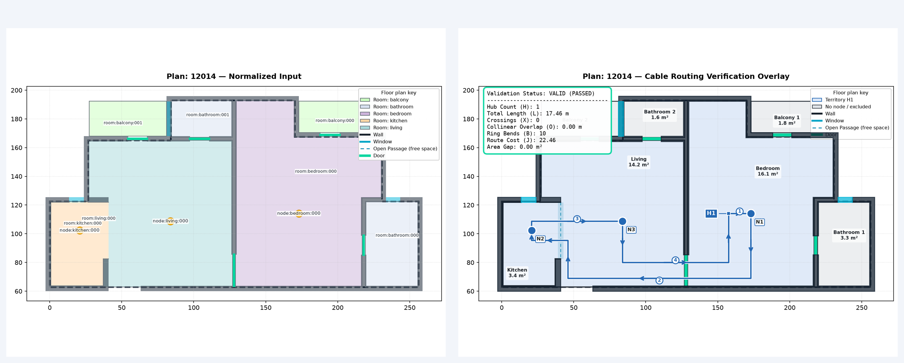
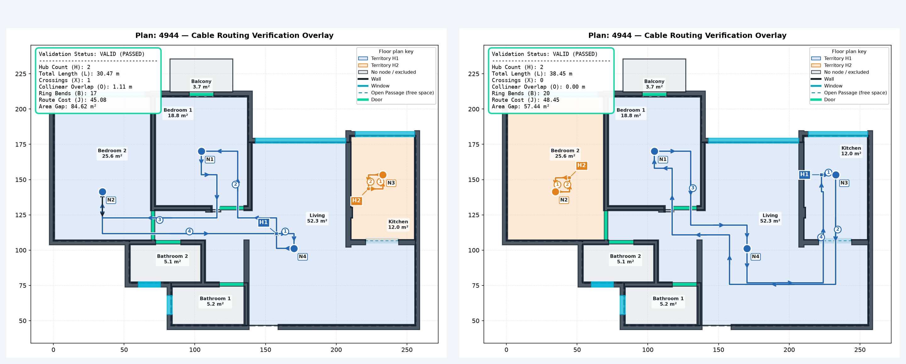

# HACKHIVE 2026 | HONEYWELL PS4

## Cable Ring Planner

**Team:** npminstallregrets | **Package:** npminstallregrets_PS4

**GitHub:** [Project repository](https://github.com/npm-install-regrets-2/hackhive-cable-routing)

We built a floor-plan planner that chooses hub locations, assigns eligible rooms to connected territories, routes a closed cable ring through every assigned node, and independently checks the result. The input is the ResPlan dataset supplied for the hackathon. Our contribution is the challenge-specific normalization, solver, checker, visual demo, and export pipeline.

**What the prototype demonstrates.** On selected real ResPlan plans, the checker accepts complete solutions with the minimum hub count implied by the area and node capacities. Within that hub count, the solver searches for a low weighted cable cost. The displayed route cost is best found within a bounded search; global route-cost optimality is not claimed.

---

## 1. The challenge

Each eligible living, bedroom, kitchen, or storage polygon has one fixed node. A selected hub owns a connected territory of rooms reached through verified doors or open passages. Its capacity is at most 100 square metres of eligible-room area and five nodes. A hub sits within one of its assigned eligible rooms and keeps at least 0.5 metres from walls.

Every hub starts and ends one closed ring visiting its assigned nodes exactly once. Cable legs are horizontal or vertical, remain inside the internal boundary, and avoid walls, windows, and exterior space. Retracing is allowed and counted. The checker ranks feasible solutions first by hub count H, then by J = L + 5X + O + 0.5B, then by assigned-area gap. L is total cable length in metres, X crossing points, O overlapping length in metres, and B bends or reversals. The geometric tolerance is 1 mm.

The newer eight-slide challenge deck specifies five nodes per hub. An older statement says 20 devices per panel; the implementation follows the newer deck and keeps capacity configurable. The organizer has not provided a complete machine-readable input/output contract or fixed challenge-node points in the ResPlan archive.

**Workflow:** trusted ResPlan item -> geometry normalization -> eligible rooms and fixed/fallback nodes -> verified portals -> hub candidates and connected assignments -> rectilinear closed rings -> independent validation and metrics -> 2D/3D demo and JSON export.

## 2. The supplied dataset and our transformations

ResPlan version 6 supplies 17,000 residential floor plans as vector polygons, architectural features, room labels, graph information, plan IDs, and area metadata. We used `ResPlan.pkl` for geometry and `split.json` to identify dataset splits. `croissant.json`, the dataset README, and LICENSE provide provenance and attribution; they are not solver inputs. The team did not collect a new dataset.

The source geometry uses drawing units. For each plan we derive drawing units per metre from the internal-area geometry and declared area; room areas and route lengths are then converted to physical units. Normalization splits multipart eligible rooms, repairs or rejects unusable geometry with diagnostics, creates stable IDs, and verifies portals geometrically. Generic graph adjacency alone is insufficient evidence of a legal opening.

The archive does not supply the challenge's fixed node coordinates. The checked examples therefore use deterministic **development fallback nodes**, labelled as such in the Plan JSON. An organizer-provided node set must replace them for a true organizer benchmark. The exact Kaggle version and the conflicting license metadata are recorded in DATASET.md.

**Where the data goes:** raw archive -> `ingestion/normalize.py`; room and portal geometry -> `geometry/` and `solver/`; normalized Plan -> shared schema -> solver and independent checker; checked Plan + Solution -> figures, interactive demo, and export adapter. The raw pickle is deliberately absent from this report ZIP and Git repository.

## 3. How the planner works

**Normalization and geometry.** The loader accepts a trusted local pickle, selects a plan by ID, derives scale, extracts individual eligible room polygons, assigns deterministic fallback nodes where needed, and constructs obstacles and verified doors/open passages. Invalid or unusable inputs return explicit diagnostics.

**Hub count and territories.** The arithmetic lower bound is max(ceil(total eligible area / 100), ceil(node count / 5)). The solver generates legal hub candidates, searches connected room assignments under both capacities, and increases the hub count when needed. Equality with the lower bound proves that no solution can use fewer hubs under the configured rules.

**Rings and routes.** The active solver uses an obstacle-aware rectilinear Hanan grid for legal legs. It evaluates complete closed tours and ranks them by the challenge's lexicographic objective. The local judge-comparison feature inspects complete candidates from the bounded search and independently checks a qualifying zero-crossing alternative. A separately requested higher-hub-count comparison is also available for local plan 16416; it is a cable-management option, not the primary ranked solution.

**Independent verification.** `validation/` checks room/node assignments, capacity, territory connectivity, hub location, ring closure and visits, axis alignment, and geometry. `metrics/` recomputes H, L, X, O, B, J, and area gap from the polylines. The 2D overlay and PDF run report display checked values. Development JSON uses drawing units; the provisional slide-8 export converts to metres and must be reviewed against any final organizer schema.

**Technology by purpose:** Python, Shapely, and NetworkX handle geometry and routing; Matplotlib draws checked overlays; FastAPI, React/Vite, and Three.js serve the demo; ReportLab builds PDFs; JSON Schema and pytest check outputs.

## 4. Checked examples

**Plan 12014** is a quick single-ring example: one hub equals the one-hub capacity lower bound. Its independently checked J is 22.4604. **Plan 8063** is a two-hub clean-ring example: two hubs equal its lower bound, with checked J 34.7645 and no crossing or overlap. These are curated demo cases, not a representative runtime benchmark.

**Plan 4944** illustrates the weighted tradeoff. Its selected two-hub route has L = 30.4697 m, X = 1, O = 1.1117 m, B = 17, J = 45.0814. The best zero-crossing candidate found in the same bounded search has L = 38.4531 m, X = 0, O = 0, B = 20, J = 48.4531. Both pass independent validation and use the proven minimum of two hubs. The cleaner-looking alternative costs 3.3717 more under J. Neither ring is claimed to be a global J optimum.

## 5. Demo, outputs, and limits

Run the local FastAPI and React/Vite demo as described in REPRODUCE.md. Select bundled plan 4944 and press Run to see the source floor plan, chosen route, checked zero-crossing alternative, metrics, and JSON downloads. The interactive 3D viewer illustrates the checked geometry with schematic heights. Local plan ID 16416 demonstrates an explicitly requested two-hub clean alternative to a one-hub selected solution; hub count remains the primary competition objective.

The ZIP includes schema-valid Plan + Solution examples for 12014, 8063, and 4944, plus the separately checked 4944 alternative. It includes the development schema for interpreting them. Provisional slide-8 exports and the final organizer schema are different contracts; use the repository exporter only after confirming the organizer's current requirements.

**Limits:** this package documents selected development examples with fallback nodes, not a hidden-test score or proof that all raw ResPlan plans are feasible. The bounded search does not certify the globally smallest J. Some raw geometry fails normalization. The latest judge-comparison branch is being submitted for teammate review; it is not represented as already deployed. The supplied dataset link is provenance, not confirmation that a link alone satisfies the organizer's OneDrive upload instruction.

**Sources:** Honeywell PS4 detailed slide deck and original problem statement supplied to the team; the project's PROJECT_PLAN.md and CONTEXT.md; ResPlan version 6 dataset metadata; checked Plan/Solution JSON and independent validation in this repository. See DATASET.md and REPRODUCE.md for exact paths and commands.
